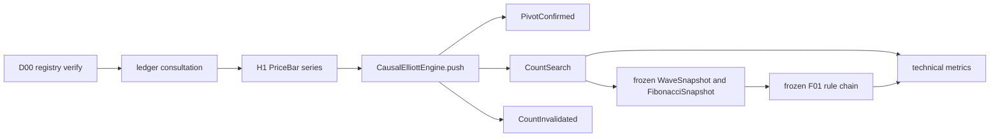

# P04-R01-E00 — Experimental Causal Elliott Swing and W1/W2 Research

Status: **CLOSED / FROZEN**

E00 delivers a research-only causal Elliott prototype under
`research/elliott_causal/`, proves it non-repainting, connects it unchanged to
the frozen P04-F01 qualification rules, and validates it technically on the
D00 March 2012 sample. It measures no economic performance and authorizes
nothing downstream.

## 1. Authority and scope

Authorized by the owner's P04-R01-E00 implementation authorization within
[P04-R01-G00](P04_R01_G00_RESEARCH_GOVERNANCE_AND_CAUSAL_ELLIOTT_READINESS.md)
sections 11, 12, and 17, starting from
`f845bba6b440f5c29a1e7bd0b799ea45c51c6928` (HEAD equal to `origin/develop`).

| Path | Purpose |
| --- | --- |
| `research/elliott_causal/**` | prototype package (9 modules) |
| `research/tests/**` | E00 fixtures and tests (`e00_fixtures.py`, `test_e00_*.py`) |
| `docs/project/P04_R01_E00_CLOSURE.md` | this record |
| `docs/project/ROADMAP.md` | E00 and Q00 status |

Nothing under `epip/`, `tests/`, `MQL5/`, or `.github/workflows/` changes. The
D00 package is consumed through its public API and is not modified.

## 2. Architecture



| Module | Responsibility |
| --- | --- |
| `contracts.py` | immutable bars, pivots, counts, events, pre-declared `EngineConfig` |
| `engine.py` | incremental ATR swing producer, rolling W1/W2 search, invalidations |
| `frozen.py` | public-constructor frozen snapshots and the five F01 rules in-process |
| `pipeline.py` | engine plus qualification, prefix-invariance checker, synthetic series |
| `dataset.py` | governed D00 access: allow-list, registry verify, ledger first |
| `metrics.py` | technical metrics only |
| `cli.py`, `__main__.py` | `technical` and `benchmark` commands |

## 3. Detection methodology

Pre-declared parameters, never tuned on market data (`EngineConfig`):
ATR period 14 (Wilder), reversal threshold 3.0 ATR, search window 12 pivots,
at most 4 alternates, degree-scale gap at most 1.

- **ATR** uses true range with the previous close and only bars up to the
  current closed bar.
- **Swings** follow an ATR-scaled zig-zag. While a leg rises, the running high
  is tracked; a HIGH pivot is confirmed on the first later bar whose low is at
  least `3.0 × ATR` below it, and symmetrically for lows. A bar that both makes
  a new extreme and reverses moves the extreme and confirms nothing, because
  the intrabar order is unknown. An initial outside bar likewise waits.
- **Research scale** of an amplitude `x` ATR: `0` below two thresholds, then
  `floor(log2(x / 3.0))`. Scales 0–5 map to the frozen degree labels
  SUBMINUETTE, MINUETTE, MINUTE, MINOR, INTERMEDIATE, PRIMARY. This is an
  amplitude-derived research label, not a calibrated Elliott degree.

## 4. Causality semantics and availability timestamps

Every pivot carries four distinct facts: the extreme price, the extreme bar
(`extreme_index`, `extreme_start_ms`), and the confirming bar
(`available_index`, `available_ms` = that bar's close). The contract refuses a
pivot available on its own extreme bar. Every event — pivot, count search,
invalidation — is stamped with the close of the bar that produced it.

Decisions are never backdated to the extreme and never rewritten. A count
whose W1 origin is later breached produces a new `CountInvalidated` event at
the breaching bar; the earlier publication is unchanged. Frozen snapshots are
timestamped at availability, not at the extreme.

## 5. Count search, ranking, and alternates

When a pivot confirms, it is treated as a potential W2 end `c`: a LOW for an
UP count, a HIGH for a DOWN count. The search enumerates every pair (W1 start
`a`, W1 end `b`) among the last 12 confirmed pivots, never the first swings of
history, and applies the hard rules in order, recording the first failure:

| Reason | Rule |
| --- | --- |
| `W1_NOT_DIRECTIONAL` | W1 moves in the count direction |
| `W1_START_NOT_EXTREME` | W1 start is the most extreme opposite point of W1 |
| `W1_END_NOT_EXTREME` | W1 end is the most extreme point from W1 start to W2 end |
| `W2_END_NOT_EXTREME` | W2 end is the most extreme point of W2 |
| `W2_BEYOND_W1_ORIGIN` | W2 never retraces 100 % or more of W1 |
| `DEGREE_INCONSISTENT` | W1 and W2 research scales differ by at most 1 |

Eligible counts are ranked by an **uncalibrated research score** in [0, 1]:
half proximity of the W2 retracement to 0.618, half W1 size relative to the
largest eligible W1. Ties break deterministically by larger W1, then the more
recent W1 start, then the more recent W1 end. The first count is the primary;
the next up to four are alternates. A search with no eligible count is still
published, with `primary = None`. The score is never written into a frozen
probability field.

## 6. Shared Elliott/Fibonacci anchoring

For every count, `FibonacciSnapshot.retracement` and `.extension` use exactly
the W1 start and end prices; the snapshot and retracement directions are
BULLISH for an UP W1 and BEARISH for a DOWN W1. Retracement levels (0.236 to
0.786) and extension levels (1.0, 1.272, 1.618 from the W2 end) derive from the
same W1. Fibonacci is never anchored on the last two market swings
independently. The frozen Fibonacci analyzer is not used or modified.

## 7. Frozen-contract integration

`WaveSnapshot`, `ElliottAnalysis`, `WaveCount`, `Wave`, `WaveSequence`,
`WaveProjection`, `AlternateCount`, and `FibonacciSnapshot` are built through
their public constructors. Fields that would need calibration
(`WaveCount.confidence`, `.probability`, confluence,
`FibonacciSnapshot.probability`) are `0.0`, meaning "not estimated". The five
frozen F01 rules run through the public `RULE_SET` in governed order with their
barriers; no production class is subclassed, patched, or mutated.

| Class | Meaning | Evidence |
| --- | --- | --- |
| A | research candidate causally identified | every published primary |
| B | frozen snapshots represent it | constructors and source bindings accept it; failure is reported as `B_NOT_REPRESENTABLE` |
| C | frozen F01 accepts it | all five rules return SUCCESS |
| D | not accepted by a documented frozen restriction | rule, state, and diagnostics are recorded |

**Finding E00-F1 (resolves the G00 section 5 contradiction in research).**
With causal W1 selection and shared anchors, the frozen F01 chain accepts the
prototype's counts unchanged. The anchor contradiction is a property of the
frozen *producers*, not of the F01 rules.

**Finding E00-F2 (frozen restriction, not bypassed).** F01 requires
`ElliottAnalysis.alternates` to be empty. Whenever the search finds more than
one eligible count, the faithful snapshot carries alternates and
`applicability.elliott-wave3` returns `REJECTED / RULE_REJECTED`; downstream
rules are not called. A separately labelled `PRIMARY_ONLY` mode, which omits
the alternates, is measured only to size this restriction. It never replaces
the faithful result. G00 section 6 assigns the decision to C00.

## 8. Test evidence

| Gate | Result |
| --- | --- |
| Research tests | 251 passed (D00 164, E00 87): twice with identical results on Linux, once on the owner's Windows Python 3.13 |
| E00 line coverage | 100.00 % of 929 statement lines (local standard-library line tracer) |
| D00 line coverage | 100.00 % of 2,071 statement lines, unchanged |
| Static checks | Black, Ruff (default and preview), strict MyPy on `research/elliott_causal`, `research/datasets`, `research/tests` (36 files) |
| Prefix invariance | 0 violations: every bar of five 260-bar series, 60 sampled bars of two 2,500-bar series, and every bar of both real series |
| Production collection | 3127, unchanged |
| Compliance | inventory 612, digest `92b40f1dfec340c886345710bf4a446b5a2dafa753b7129c12c7d3488c46f3f1`, unchanged |
| F01 identities | the five fingerprints equal the P04-F01-R01 table (`test_frozen_f01_identities_are_unchanged`) |

Requirement mapping (prefixes: E `test_e00_engine.py`, F `test_e00_frozen.py`,
D `test_e00_dataset_cli.py`):

| # | Requirement | Executed tests |
| --- | --- | --- |
| 1 | No future-bar access | E `test_future_bars_never_change_published_output`, `test_intentional_look_ahead_control_is_flagged` |
| 2 | Pivot confirmation latency | E `test_handcrafted_pivots_are_confirmed_one_bar_after_their_extreme`, `test_every_pivot_is_available_strictly_after_its_extreme`, `test_pivot_contract_refuses_same_bar_availability` |
| 3 | Swing prefix invariance | E `test_prefix_invariance_on_every_bar_including_frozen_outcomes`, `test_prefix_invariance_on_long_series_at_sampled_bars` |
| 4 | Repeated confirmation stability | E `test_each_pivot_is_confirmed_once_and_kinds_alternate`, `test_outside_bar_does_not_confirm_until_order_is_known`, `test_extreme_bar_that_also_reverses_moves_the_extreme_first` |
| 5 | Rolling window | E `test_search_reads_only_the_recent_window_never_the_first_swings`, `test_count_search_enumeration_is_bounded_by_the_window` |
| 6 | W1/W2 geometry | E `test_every_eligible_count_satisfies_geometry_direction_and_degree` |
| 7 | Wave direction | E `test_handcrafted_up_and_mirrored_down_counts`; F `test_frozen_snapshots_are_built_through_public_constructors` |
| 8 | W2 non-invalidation | E `test_breach_of_w1_origin_emits_a_new_invalidation_event`, `test_each_hard_rule_rejects_with_its_reason` |
| 9 | Degree consistency | E `test_every_eligible_count_satisfies_geometry_direction_and_degree`, `test_research_scale_doubles`; F `test_degree_mapping_is_clamped` |
| 10 | Alternate ordering | E `test_candidates_are_ranked_with_deterministic_tie_breaking`, `test_tie_break_prefers_recent_anchors` |
| 11 | Hard-rule rejection | E `test_each_hard_rule_rejects_with_its_reason` (all six reasons) |
| 12 | Explicit anchor equality | F `test_fibonacci_anchors_and_direction_follow_w1_exactly`, `test_anchor_continuity_holds_for_every_published_primary` |
| 13 | Fibonacci direction continuity | F `test_fibonacci_anchors_and_direction_follow_w1_exactly` |
| 14 | Frozen snapshot construction | F `test_frozen_snapshots_are_built_through_public_constructors`, `test_unrepresentable_input_is_class_b_not_a_crash` |
| 15 | F01 acceptance | F `test_frozen_f01_chain_accepts_single_count` |
| 16 | F01 rejection diagnostics | F `test_alternates_are_a_documented_frozen_restriction_with_barrier`, `test_each_f01_rejection_stage_is_reported`, `test_primary_only_mode_never_replaces_faithful_reporting` |
| 17 | Zero eligible counts | E `test_zero_eligible_counts_are_published_explicitly` |
| 18 | Multiple eligible counts | E `test_every_eligible_count_satisfies_geometry_direction_and_degree`; F `test_alternates_are_a_documented_frozen_restriction_with_barrier` |
| 19 | Incomplete coverage rejection | D `test_incomplete_coverage_is_refused_before_consultation`, `test_incomplete_bars_and_tampering_are_refused`, `test_tampered_files_fail_registry_verification` |
| 20 | Deterministic results | E `test_same_input_same_output_and_thread_safety`; D `test_cli_technical_report_is_deterministic_and_non_economic`, `test_benchmark_detects_a_non_deterministic_run` |
| 21 | Concurrency and immutability | E `test_same_input_same_output_and_thread_safety` |
| 22 | No network access | D `test_network_is_forbidden` (autouse socket guard for all research tests) |
| 23 | No production modification | D `test_research_package_never_subclasses_or_patches_production`, `test_frozen_f01_identities_are_unchanged`; D00 `test_frozen_production_contract_isolation` |
| 24 | No OOS consultation | D `test_only_authorized_technical_datasets_are_readable`, `test_authorized_ids_are_exactly_the_d00_technical_h1_identities`, `test_ledger_is_written_before_canonical_content_is_read` |

### Gherkin scenarios

```gherkin
Scenario: Pivot availability
  Given a pivot whose extreme is bar e
  When it is confirmed by the reversal on bar c
  Then c > e and its availability is the close of bar c

Scenario: Prefix invariance
  Given any bar t of a series
  When the pipeline runs on the series truncated at t
  Then its output equals everything the full run published up to t,
    including pivots, counts, alternates, anchors, snapshot identities,
    and frozen F01 outcomes

Scenario: Look-ahead control
  Given a producer that backdates its events
  Then the prefix-invariance checker reports violations

Scenario: Non-repainting invalidation
  Given a count published at bar c
  When a later bar breaches the W1 origin
  Then a CountInvalidated event is published at that bar
  And the publication at c is unchanged

Scenario: Rolling window
  Given a growing history
  Then every search reads only the last 12 confirmed pivots

Scenario: Shared anchors
  Given a published primary count
  Then Fibonacci retracement and extension anchors equal W1 start and end
  And the Fibonacci direction follows W1

Scenario: Frozen F01 acceptance
  Given a single eligible count
  Then the five frozen F01 rules return SUCCESS unchanged

Scenario: Frozen restriction
  Given several eligible counts in faithful mode
  Then applicability.elliott-wave3 returns REJECTED
  And no downstream F01 rule is invoked
  And the restriction is recorded as class D

Scenario: Governed data access
  Given a dataset outside the authorized TECHNICAL H1 list,
    or with incomplete coverage
  Then it is refused before any ledger record or content read
  And an authorized dataset is recorded in the ledger before its content is read
```

## 9. Real technical sample results

Consulted on 2026-11-24 (ledger: two TECHNICAL records, experiment
`P04-R01-E00-technical-f825eee579c84537`), BID side, observation period
2012-03-12 00:00 to 2012-03-16 21:00 UTC. Report
`data/reports/e00_technical_BID_fe7dd891020fe355.json` (local, not committed).

| Metric | EURUSD | XAUUSD |
| --- | --- | --- |
| Dataset (`dataset_id` prefix) | `a4c33c19042a` | `ce4d98346a84` |
| H1 bars | 117 | 116 |
| Confirmed pivots | 7 | 10 |
| Confirmation latency, bars (min / median / max) | 2 / 6 / 15 | 2 / 8 / 20 |
| Count searches / with an eligible count | 7 / 3 | 10 / 5 |
| Eligible W1/W2 candidates | 4 | 11 |
| Eligible candidates by day (12–16 March) | 0, 0, 1, 0, 3 | 0, 3, 3, 0, 5 |
| Enumerated pairs (total / max per search) | 14 / 6 | 40 / 10 |
| F01 faithful: accepted (C) / restricted (D) | 2 / 1 | 2 / 3 |
| F01 primary-only: accepted (C) | 3 | 5 |
| Invalidations | 1 | 0 |
| Anchor-continuity failures | 0 | 0 |
| Prefix-invariance violations (bars checked) | 0 (117) | 0 (116) |

Rejection categories: EURUSD — `W1_START_NOT_EXTREME` 4,
`W2_BEYOND_W1_ORIGIN` 3, `W2_END_NOT_EXTREME` 2, `W1_END_NOT_EXTREME` 1.
XAUUSD — `W1_END_NOT_EXTREME` 10, `W1_NOT_DIRECTIONAL` 6,
`W2_BEYOND_W1_ORIGIN` 6, `W1_START_NOT_EXTREME` 4, `W2_END_NOT_EXTREME` 3.
Every class-D outcome is the empty-alternates restriction (E00-F2).

One technical week validates data contracts, causality, anchoring, and frozen
compatibility. It says nothing about Wave 3 effectiveness, frequency at
scale, or profitability.

## 10. Performance evidence

Deterministic generated series (`generated_bars`, seed 1), full pipeline
including both F01 qualification modes, timing run separate from the
memory-tracing run, with a deterministic rerun check:

| Machine | Bars | Published events | Seconds | Peak traced memory |
| --- | --- | --- | --- | --- |
| Linux research container | 100,000 | 9,785 | 4.2 (engine alone 0.3) | 8.9 MiB |
| Owner Windows, Python 3.13 | 100,000 | 9,785 | 7.2 | 8.9 MiB |

The G00 indicative target (about 100,000 H1 bars in under 60 seconds) is met.

## 11. Known limitations

- One zig-zag scale; nested sub-degree structure inside W1 or W2 is not
  modelled. Degree is an amplitude label.
- The ranking score is uncalibrated; frozen probability and confidence fields
  are `0.0`. Calibration requires Q00 data.
- The empty-alternates F01 restriction (E00-F2) rejects every faithful
  multi-count search.
- Confirmation latency (median 6–8 H1 bars on the sample) contrasts with the
  frozen P04-F00 300-second expiration and 0-second freshness; F01 does not
  evaluate them, and E00 does not decide them (G00 section 6, C00 decision B).
- The parameters are pre-declared, not validated; sensitivity belongs to Q00.
- Research CI (`research.yml`, unchanged) runs every research test including
  E00, but its Black, Ruff, and MyPy steps cover `research/datasets` and
  `research/tests` only and its coverage gate measures `research/datasets`.
  Static checks and coverage of `research/elliott_causal` are local evidence.
  Extending the workflow requires a separately authorized change.

## 12. Research and production separation

`research/elliott_causal` imports `epip` read-only through public modules and
the D00 package through its API. `epip` never imports `research`. No frozen
identity, fingerprint, compliance inventory, or production test changes. Data
stay under `data/` (ignored by Git). The only ledger consultations are the two
TECHNICAL records above; no OOS partition was read.

## 13. Reproducible commands

```powershell
cd C:\Users\Ansible\Documents\GitHub\EPIP
$py = ".\.venv313\Scripts\python.exe"
& $py -m pytest -q -p no:cacheprovider research/tests
& $py -m research.elliott_causal technical            # appends TECHNICAL ledger records
& $py -m research.elliott_causal benchmark --bars 100000 --seed 1
& $py -m black --check research/elliott_causal research/datasets research/tests
& $py -m ruff check research/elliott_causal research/datasets research/tests
& $py -m mypy --explicit-package-bases research/elliott_causal research/datasets research/tests
```

## 14. Q00 prerequisites

Q00 remains **not authorized**; E00 only makes it ready for an authorization
review. Before Q00 starts:

1. a frozen, pre-registered Q00 protocol (G00 sections 13 and 14);
2. a governed development dataset beyond the technical week (a new D00-style
   acquisition authorization; the technical sample has no statistical
   standing);
3. a decision on how alternates are handled when measuring setup frequency
   (faithful versus primary-only, E00-F2);
4. treatment of confirmation latency against the frozen 300-second expiration;
5. parameter sensitivity limited to pre-declared grids, with multiple-testing
   control;
6. forward OOS only, per the G00 section 10 ledger.

C00, P04-F02, P04-F03, P04-F04, and P05 remain not authorized.
